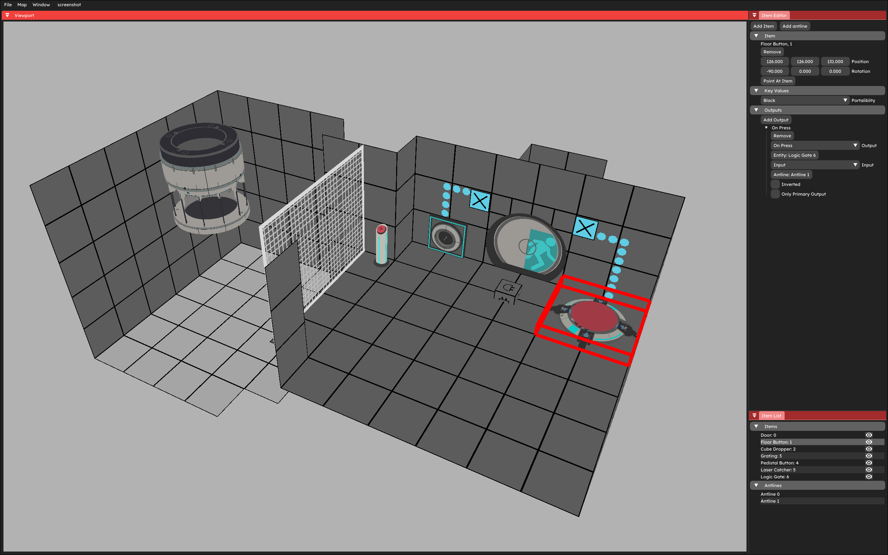
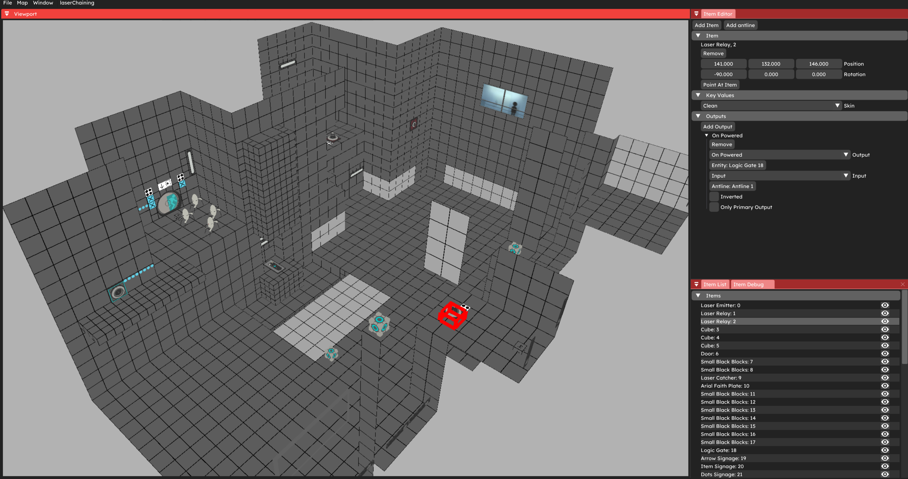
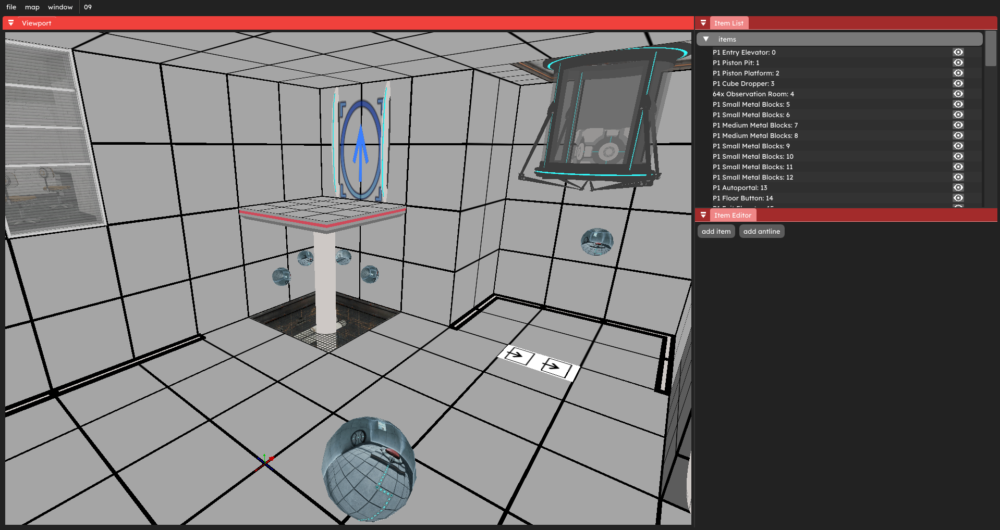

# Overview
A puzzlemaker for Portal 2: Community Edition

It has a 64 hammer unit grid which is the size of one medium tile.
Items that can snap to several different points on voxels and can have their position and rotation adjusted to make off grid placements very simple.
Currently antlines are manually routed but they can automatically generate a corner at the start of each segment depending on how they are configured.

Everything is highly configureable through packages.
Packages can contain their own items and themes, themes can change all of the voxel textures, resize and retexture antlines and contain several different post processing presets.
There are several types of items: Entity, Panel, Volume and Overlay.
 - Entity items are the standard item type, they are good for most items like cubes and buttons.
 - Panel items are scalable, and can have up to 8 border components and props on the edge of each border, good for fizzlers, glass or grating.
 - Volume items are also scalable and can have different textures on each face, good for triggers and toxic goo.
 - Overlay items are overlays that can be placed on voxels and the faces of some volume items, good for test chamber signage.
All items can have export scripts attached for more complex behaviors.

The base packages contain most items from PETI as well as several helper items for things like triggers, map start and end as well as many other things.

# Installation
1. Download the latest release and unzip it.
2. If your P2CE installation is not in the default location `C:\Program Files (x86)\Steam\steamapps\common\Portal 2 Community Edition` or you are on linux you will need to modify the p2ce field inside compileSteps.json to point to your game installation. Make sure each space in the path is prefixed with a `%` so `Portal 2 Community Edition` becomes `Portal% 2% Community% Edition`

# Usage
Movement and voxel modification works similar to how PETI does it. Items and antlines have all of their configuration options in a panel on the right.
Some of the basic binds are:
 - 2 to push voxels
 - 3 to pull voxels
 - R to toggle portalibility
 - G to grab item to be moved with mouse
 - Q to rotate item 90 deg left
 - E to rotate item 90 deg right
 - C to open item placement menu
For a full list of key binds open the keybinds window at window -> keybinds

# Documentation
All of the documentation for Items, Themes and the script system are in the docs directory.  
There are also some json schema files which your lsp can use for autocomplete.

# Community Packages
### Portal 1 Theme and Helper Items by Crazy.Hair
[Github](https://github.com/crazy-hair/p2ce-puzzlemaker-assets)

